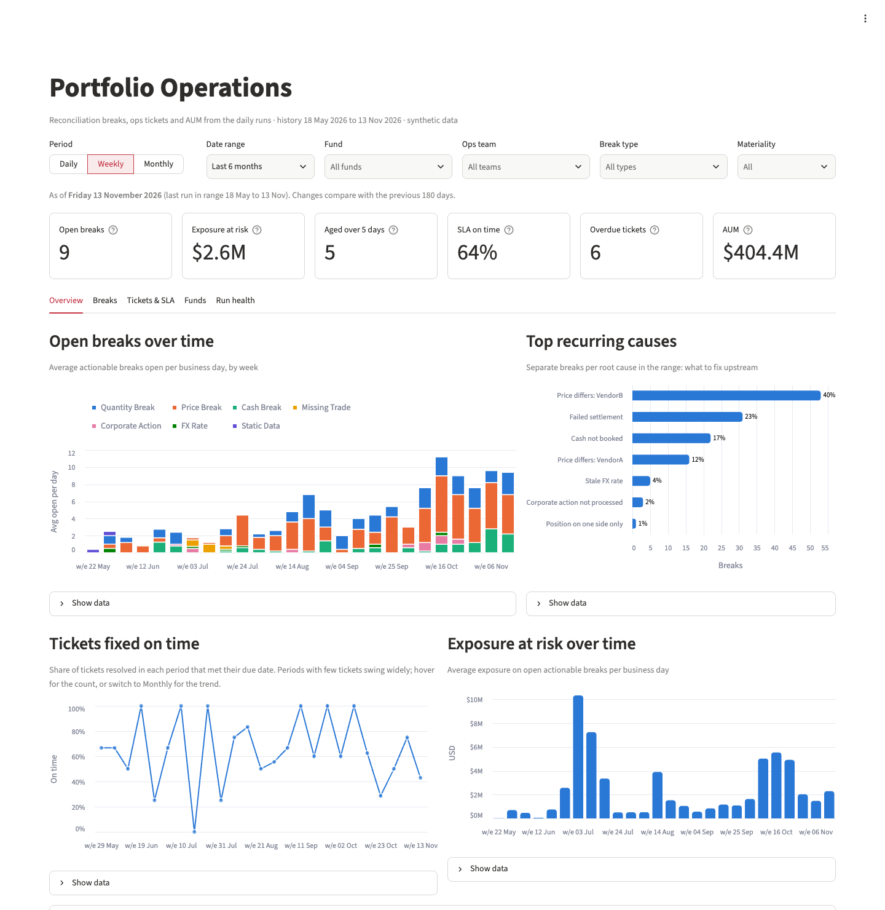
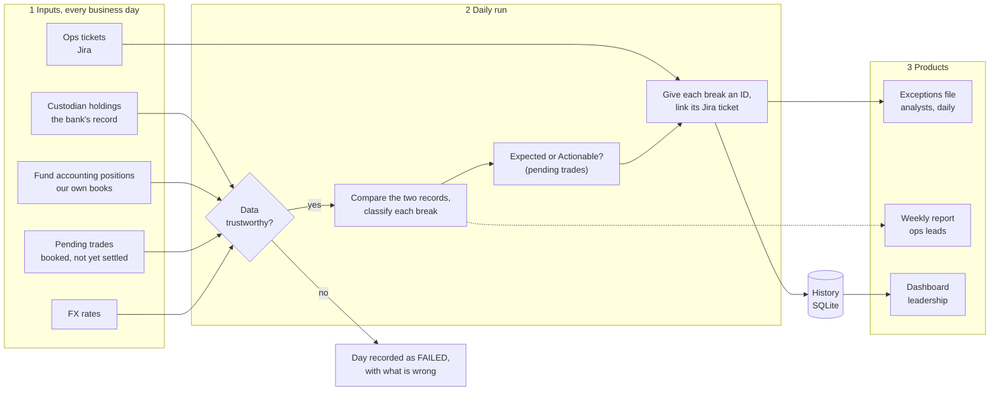

# Portfolio Ops Reporting

A Python pipeline that checks an investment firm's two records of what its
funds own against each other **every business day**, keeps the history, and
turns it into three products: a daily to-do list for operations analysts, a
weekly report, and a leadership dashboard.

> A self-directed project modelling a real reporting workflow in asset
> management. All data is synthetic.

**New to this industry?** Start with [docs/CONCEPTS.md](docs/CONCEPTS.md): the
business explained with everyday analogies and a glossary.



## The problem, in plain English

An investment firm runs **funds**: pools of investors' money. Two parties each
keep a record of what every fund owns:

- The **custodian**: the bank that actually holds the fund's shares, bonds and
  cash for safekeeping. (Custodian means "has custody of the assets". It is not
  a customer.)
- **Fund accounting**: the firm's own official books, where every trade is
  recorded as soon as it is made.

It works like checking your own budgeting spreadsheet against your bank
statement. The two should match. When they don't, the difference is called a
**break**, and it must be found, explained and fixed, because the fund's value
reported to investors is calculated from those books. Funds are priced every
day, so the check runs every day.

Some breaks are only **timing**: a share purchase is in the books on the day
it is agreed but reaches the bank a day or two later. Those are **Expected**
and need no action. The rest are **Actionable** and get a Jira ticket with a
deadline.

## Three products, three audiences

| Product | Who uses it | Question it answers | How often |
|---|---|---|---|
| **Exceptions file** (Excel) | Ops analysts | What do I need to fix today, most urgent first? | Every business day |
| **Weekly report** (Excel, 7 tabs) | Ops leads, fund controllers | Where do we stand this week: breaks, fund values, ticket deadlines? | Weekly |
| **Dashboard** (web) | Managers, leadership | Are we keeping up? Which team, fund or root cause is the problem? Daily, weekly or monthly | Any time |

All three read the same daily results, so they cannot disagree with each other.

## Pain points this solves

| Without this | With this |
|---|---|
| Someone compares two big spreadsheets by hand | One command compares every holding in under a second |
| Analysts chase breaks that will fix themselves tomorrow | Breaks explained by trades not yet settled are marked Expected and kept off the to-do list |
| The bank's file layout changes and values land in the wrong column unnoticed | Columns are matched by name; an unexpected layout stops the run with a clear message |
| A missing row quietly shrinks the total | Rows read must add up to the total printed on the bank's statement |
| "They don't match" with no idea why | Each break is labelled with a type, a likely cause, and an ID it keeps until it is fixed |
| Nobody knows which tickets are late | Each break is linked to its Jira ticket; open, overdue and on-time rates per team |
| Leadership sees today, never the trend | Six months of daily history, viewable by day, week or month, with the top recurring causes |
| An upstream change breaks the script at 7am | A runbook maps each error message to a cause and an action; a failed day is recorded, not skipped silently |

## How it works, end to end



1. **Inputs.** Four Excel files arrive for each business day, and the ops
   team's tickets come from Jira.
2. **Daily run.** The files are read and checked before any number is trusted.
   Every holding is compared; each difference becomes a break with a type and a
   likely cause. Breaks fully explained by trades that haven't reached their
   settlement date are **Expected**. Each break keeps one ID from the day it
   appears until it clears, and is linked to its ticket.
3. **History.** Each day's results are saved, including days that failed.
4. **Products.** The analysts' exceptions file is written each morning; the
   dashboard reads the history; the weekly report runs on Fridays.

The step-by-step technical version, with a module map, is in
[docs/ARCHITECTURE.md](docs/ARCHITECTURE.md).

## What comes out

**Daily:** `output/daily/<date>/ops_exceptions_<yyyymmdd>.xlsx`

| Tab | What it tells you |
|---|---|
| Action Today | Actionable breaks, most urgent first: overdue tickets, then breaks with no ticket yet, then by size. What to check for each |
| Expected | Breaks explained by pending trades, with the settlement date. No action unless still there after it |
| Cleared | Breaks fixed since the previous business day |
| Data Quality | Every problem found in the inputs |

**Weekly:** `output/<date>/portfolio_ops_report_<yyyymmdd>.xlsx` with seven
tabs: Summary, Breaks, AUM, Ops SLA, Overdue Tickets, Data Quality, Run Info.

**Dashboard:** filters for period (daily, weekly, monthly), date range, fund,
ops team, break type and materiality. Tabs: Overview, Breaks, Tickets & SLA,
Funds, Run health.

In the sample data (six months to 13 Nov 2026): 5 funds worth $404M; open
breaks per day roughly triple from October as fixes slow down; the top
recurring cause is one pricing vendor (40% of breaks). That is the kind of
pattern the dashboard is built to surface.

## Try it

```bash
git clone https://github.com/reddyakilesh22-glitch/portfolio-ops-reporting.git
cd portfolio-ops-reporting
python3 -m venv .venv && .venv/bin/pip install -r requirements-dev.txt

# Six months of daily sample data (about 5 seconds; not stored in git)
.venv/bin/python -m scripts.generate_daily_data

# Run every business day into the history (about 25 seconds)
.venv/bin/python -m opsreport backfill --from 2026-05-18 --to 2026-11-13

# The leadership dashboard (opens in your browser)
.venv/bin/streamlit run dashboard/app.py

# One day, as an analyst would each morning
.venv/bin/python -m opsreport daily --as-of 2026-11-13

# The weekly report (sample files are included)
.venv/bin/python -m opsreport run --as-of 2026-11-13 --prior 2026-11-06

# The tests
.venv/bin/pytest -q
```

| Command | What it does |
|---|---|
| `daily --as-of DATE` | Reconcile one business day, save it to the history, write the exceptions file |
| `backfill --from A --to B` | Run every business day in a range, in order. A bad day is recorded and the rest continue |
| `run --as-of DATE --prior DATE` | The weekly report |
| `run ... --jira live` | Pull tickets from Jira now (needs `.env`) instead of the saved copy |
| `run ... --commentary local-llm` | Have a local AI model write the summary; see [AI commentary](docs/AI_COMMENTARY.md) |

Exit codes: **0** done, **1** a file, Jira or setup problem, **2** the data
failed its checks (for `backfill`: at least one day failed).

<details>
<summary>Connecting your own Jira site (optional)</summary>

```bash
cp .env.example .env              # add your Jira URL, email and API token
python -m scripts.jira_setup      # creates the demo project and custom fields
python -m scripts.seed_jira       # adds 160 synthetic tickets
```

`.env` is never committed. The weekly sample Excel files can be regenerated
with `python -m scripts.generate_excel_data`.
</details>

## Project layout

```
opsreport/          the application
  extract/          read the Excel files and Jira
  validate/         data-quality checks
  reconcile/        compare the two records, classify breaks, match pending trades
  transform/        fund values (AUM) and ticket statistics
  report/           write the Excel workbooks
  ai/               optional AI summary and its fact-checker
  daily.py          the daily run and backfill
  history.py        the SQLite history store
  dashboard_data.py every number on the dashboard
  pipeline.py       the weekly run
dashboard/app.py    the leadership dashboard (Streamlit)
config/             settings: column names, tolerances, holidays, funds
data/               weekly sample files, saved Jira data, answer keys for tests
scripts/            create the sample data and the Jira project
tests/              automated tests
docs/               the documents listed below
```

## Documentation

| Document | Read it for |
|---|---|
| [CONCEPTS.md](docs/CONCEPTS.md) | The business in plain English, worked examples, glossary |
| [ARCHITECTURE.md](docs/ARCHITECTURE.md) | How the code works: each stage, the history store, the dashboard, tests |
| [RUNBOOK.md](docs/RUNBOOK.md) | Running it each day and week, and what to do when it fails |
| [INCIDENTS.md](docs/INCIDENTS.md) | Things that broke, why, and how each was fixed |
| [AI_COMMENTARY.md](docs/AI_COMMENTARY.md) | How the AI summary is kept honest |

## Built with

Python 3.11, pandas, openpyxl and XlsxWriter (Excel), SQLite (history),
Streamlit and Altair (dashboard), requests (Jira REST API), pytest, ruff and
mypy, GitHub Actions for CI (lint, types, tests, coverage floor), and
optionally Ollama for a local language model.

## Limits

This is a learning project, not production software. The data is synthetic;
fund value is simplified to total assets; one holiday calendar is used for all
markets; trades don't move cash; tickets in the daily history are generated
alongside the breaks rather than created in Jira (creating them automatically
is the next step); and the AI fact-checker catches wrong numbers, not every
misleading sentence.
