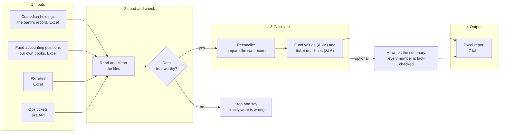

# Portfolio Ops Reporting

A Python pipeline that checks an investment firm's two records of what its
funds own against each other, and produces the weekly report on every
mismatch, the funds' total value, and how quickly mismatches are being fixed.

> A self-directed project modelling a real reporting workflow in asset
> management. All data is synthetic.

**New to this industry?** Start with [docs/CONCEPTS.md](docs/CONCEPTS.md): the
business explained with everyday analogies and a glossary.

## The problem, in plain English

An investment firm runs **funds**: pools of investors' money. Two parties each
keep a record of what every fund owns:

- The **custodian**: the bank that actually holds the fund's shares, bonds and
  cash for safekeeping. (Custodian means "has custody of the assets". It is not
  a customer.)
- **Fund accounting**: the firm's own official books, where every trade is
  recorded as soon as it is made.

It works like checking your own budgeting spreadsheet against your bank
statement. The two should match. When they don't, the difference is called a
**break**, and it must be found, explained and fixed, because the fund's value
reported to investors is calculated from those books.

## Pain points this solves

| Without this | With this |
|---|---|
| Someone compares two big spreadsheets by hand every week | One command compares every holding in under a second |
| The bank's file layout changes and values land in the wrong column unnoticed | Columns are matched by name; an unexpected layout stops the run with a clear message |
| A missing row quietly shrinks the total | Rows read must add up to the total printed on the bank's statement |
| "They don't match" with no idea why | Each break is labelled with a type and a likely cause |
| Nobody knows which task tickets are late | Open, overdue and on-time rates per team, pulled from Jira |
| Last week's numbers change when re-run | Inputs are fingerprinted and Jira pulls are saved |
| An upstream change breaks the script at 7am | A runbook maps each error message to a cause and an action |

## How it works, end to end



1. **Inputs.** Three Excel files arrive for the Friday being reported, plus
   the ops team's task tickets from Jira.
2. **Load and check.** The files are read and cleaned (the bank's file is
   messy on purpose, like real ones). Checks run before any number is trusted.
   If something is seriously wrong, the run stops instead of publishing.
3. **Calculate.** Every holding is compared between the two records. Each
   difference becomes a break with a type and a likely cause. Fund totals and
   ticket deadline statistics are computed.
4. **Output.** One Excel workbook, ready to send.

The step-by-step technical version, with a module map, is in
[docs/ARCHITECTURE.md](docs/ARCHITECTURE.md).

## What comes out

`output/<date>/portfolio_ops_report_<yyyymmdd>.xlsx`

| Tab | What it tells you |
|---|---|
| Summary | Headline numbers, a short commentary, value of each fund and its weekly change |
| Breaks | Every mismatch: which fund, which security, what kind, how big, likely cause |
| AUM | Each fund's total value, with the bank's figure alongside |
| Ops SLA | Per team: open tickets, late tickets, how old, share fixed on time; 8-week trend |
| Overdue Tickets | The late tickets, oldest first |
| Data Quality | Every problem found in the inputs |
| Run Info | Audit trail: exactly which files and code version produced this report |

For the sample week (13 Nov 2026): 5 funds worth $350.2M, 11 breaks adding up
to $14.9M, 19 open tickets of which 12 are late.

## Try it

```bash
git clone https://github.com/reddyakilesh22-glitch/portfolio-ops-reporting.git
cd portfolio-ops-reporting
python3 -m venv .venv && .venv/bin/pip install -r requirements-dev.txt

# Build the sample report. Works offline: sample data is included.
.venv/bin/python -m opsreport run --as-of 2026-11-13 --prior 2026-11-06

# Run the tests
.venv/bin/pytest -q
```

| Option | What it does |
|---|---|
| `--as-of DATE` | The Friday being reported |
| `--prior DATE` | The previous Friday, for week-over-week change |
| `--jira live` | Pull tickets from Jira now (needs `.env`, see below) instead of the saved copy. Refuses to replace an existing saved copy unless you add `--refresh-snapshot` |
| `--raw-dir DIR` | Read the input files from another folder (default `data/raw`) |
| `--commentary local-llm` | Have a local AI model write the summary; see [AI commentary](docs/AI_COMMENTARY.md) |
| `--allow-errors` | Produce a report even when checks fail. For investigation only |

The program ends with exit code **0** (report written), **1** (a file, Jira or
setup problem) or **2** (the data failed its checks; nothing published).

<details>
<summary>Connecting your own Jira site (optional)</summary>

```bash
cp .env.example .env              # add your Jira URL, email and API token
python -m scripts.jira_setup      # creates the demo project and custom fields
python -m scripts.seed_jira       # adds 160 synthetic tickets
```

`.env` is never committed. The synthetic Excel files can be regenerated with
`python -m scripts.generate_excel_data`.
</details>

## Project layout

```
opsreport/        the application
  extract/        read the Excel files and Jira
  validate/       data-quality checks
  reconcile/      compare the two records, classify breaks
  transform/      fund values (AUM) and ticket statistics
  report/         write the Excel workbook
  ai/             optional AI summary and its fact-checker
  pipeline.py     runs the steps in order
config/           settings: column names, tolerances, holidays, funds
data/             sample input files, saved Jira data, answer keys for tests
scripts/          helpers that create the sample data and Jira project
tests/            automated tests
docs/             the documents listed below
```

## Documentation

| Document | Read it for |
|---|---|
| [CONCEPTS.md](docs/CONCEPTS.md) | The business in plain English, worked examples, glossary |
| [ARCHITECTURE.md](docs/ARCHITECTURE.md) | How the code works: detailed flow, each stage, rules, tests |
| [RUNBOOK.md](docs/RUNBOOK.md) | Running it each week and what to do when it fails |
| [INCIDENTS.md](docs/INCIDENTS.md) | Four things that broke, why, and how each was fixed |
| [AI_COMMENTARY.md](docs/AI_COMMENTARY.md) | How the AI summary is kept honest |

## Built with

Python 3.11, pandas, openpyxl and XlsxWriter (Excel), requests (Jira REST
API), pytest, ruff and mypy, GitHub Actions for CI (lint, types, tests, coverage
floor), and optionally Ollama for a local language model.

## Limits

This is a learning project, not production software. The data is synthetic,
fund value is simplified to total assets, one holiday calendar is used for
all markets, and the AI fact-checker catches wrong numbers, not every
misleading sentence.
