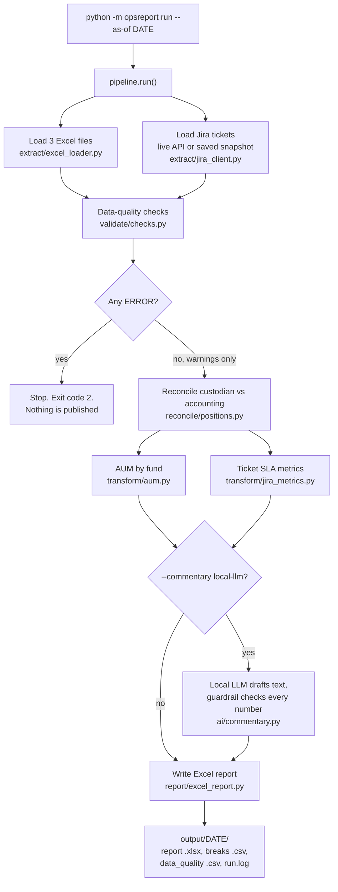

# Architecture: how the code works

Technical documentation for the pipeline. For the business meaning of the
terms used here (custodian, break, AUM), read [CONCEPTS.md](CONCEPTS.md) first.

## One run, start to finish



## Repository map

```
opsreport/                 the application
  __main__.py              command line: arguments, logging, exit codes
  pipeline.py              runs the stages in order; builds the audit trail
  config.py                reads .env and the YAML files in config/
  calendar.py              business-day maths with market holidays
  extract/
    excel_loader.py        reads the custodian, accounting and FX workbooks
    jira_client.py         Jira REST client, field mapping, snapshots
  validate/checks.py       data-quality rules (ERROR stops the run)
  reconcile/positions.py   compares the two books; classifies each break
  transform/
    aum.py                 AUM by fund and week-over-week change
    jira_metrics.py        open / overdue / aging / SLA, as of a date
  report/excel_report.py   writes the 7-tab workbook
  ai/commentary.py         optional LLM commentary plus its fact-checker

config/                    everything that changes without code changes
  funds.yaml               the funds and their custodian account numbers
  excel_layouts.yaml       column names and date formats of each source file
  jira_fields.yaml         Jira custom fields the report needs
  jira_field_lock.yaml     those fields' Jira ids, pinned per site
  recon.yaml               tolerances and materiality thresholds
  calendar.yaml            market holidays

data/
  raw/<date>/              the three input workbooks for each week
  expected/                answer keys: the breaks planted in the test data
  snapshots/               saved Jira pulls, so runs are reproducible offline

scripts/                   one-off helpers, not part of the weekly run
  generate_excel_data.py   creates the synthetic workbooks and answer keys
  jira_setup.py            creates the demo Jira project and custom fields
  seed_jira.py             fills it with 160 synthetic tickets

tests/                     89 tests; none need Jira, Ollama or the network
docs/                      CONCEPTS, ARCHITECTURE, RUNBOOK, INCIDENTS, AI_COMMENTARY
```

## Stage by stage

### 1. Extract: Excel (`extract/excel_loader.py`)

Three loaders return tables in one shared shape, so later stages never care
which system a row came from:

`source, as_of, fund_code, isin, ticker, description, asset_class, currency,
quantity, price, local_mv, fx_rate, base_mv`

| Source | What makes it awkward | How the loader copes |
|---|---|---|
| Custodian statement | Title rows above the header; one sheet per fund; numbers stored as text (`"25,000.00"`); a Total row and footer; a holding may be split over several rows | Finds the header row by scanning for `ISIN`; maps columns by header text; cleans numbers; keeps only rows for that account; adds split rows together |
| Fund accounting | Different column names; has accrued income | Maps columns by header text from config |
| FX rates | A currency may be missing or duplicated | Rejects missing, duplicate or non-positive rates |

Safety checks that stop the run with a clear message:

- **Date guard.** The date written inside each file must equal `--as-of`.
- **Control total.** The custodian rows that were read must add up to the
  statement's own Total row, within $1. Catches dropped or misread rows.
- **Known accounts only.** An unexpected or missing account sheet is an error.

### 2. Extract: Jira (`extract/jira_client.py`)

- Calls Jira's REST API with an API token from `.env`.
- Uses `POST /rest/api/3/search/jql` and follows `nextPageToken` page by page.
- Retries when Jira answers 429 (rate limited) or 5xx.
- Custom fields are looked up **by display name** (portable across Jira
  sites). Each field's id is also pinned in `jira_field_lock.yaml`; if a field
  is renamed, the run follows the id and raises a warning instead of stopping.
- Every live pull is saved as a **snapshot** with site URLs and account ids
  removed. Runs default to the snapshot, so tests and re-runs work offline.

### 3. Validate (`validate/checks.py`)

| Severity | Effect | Checks |
|---|---|---|
| ERROR | Run stops, exit code 2 | Blank required field; same fund and ISIN twice; ISIN fails its check digit; currency with no FX rate; duplicate Jira key |
| WARNING | Listed on the Data Quality tab | Quantity zero or negative; market value ≠ quantity × price; FX rate differs from the official file; Jira ticket missing a field, Done without a resolved date, or resolved before it was raised; Jira field renamed; run date is not a business day |

Checks never repair data. They say what is wrong and where.

### 4. Reconcile (`reconcile/positions.py`)

The two position tables are joined on **fund + ISIN**, keeping rows that
exist on only one side. Each joined row is tested against the rules below
**in this order**; the first rule that matches names the break.

| Order | Break type | Rule |
|---|---|---|
| 1 | Missing Trade | Exists on one side only |
| 2 | Cash Break | Cash row, value differs by more than tolerance |
| 3 | Static Data | Currency differs between the two sides |
| 4 | Corporate Action | Quantity ratio is a split ratio (2, 3, 0.5, ...) and value is unchanged |
| 5 | Quantity Break | Quantities differ |
| 6 | Price Break | Prices differ by more than 0.05% and value differs |
| 7 | FX Rate | Local-currency value agrees but dollar value differs |
| 8 | Unexplained | Value differs, no rule matched |

Order matters. A wrong currency also changes the dollar value, so it must be
labelled Static Data before the FX rule sees it. Each break also gets a
materiality band and a one-line likely cause. Tolerances live in `recon.yaml`.

### 5. Metrics (`transform/`)

- **AUM** = securities value + cash + accrued income, from fund accounting,
  with the custodian total alongside so a gap is visible.
- **Ticket metrics** are *point-in-time*: "open as of the Friday" means raised
  on or before it and not resolved by it. Ages are counted in business days
  using `calendar.yaml`.

### 6. Report (`report/excel_report.py`)

One workbook, seven tabs: Summary, Breaks, AUM, Ops SLA, Overdue Tickets,
Data Quality, Run Info. **Run Info** is the audit trail: a fingerprint
(SHA-256) of every input file, row counts, the git commit and library versions.

### 7. Optional AI commentary (`ai/commentary.py`)

Described in [AI_COMMENTARY.md](AI_COMMENTARY.md). In short: Python computes
every number; a local model only writes sentences; a fact-checker verifies
each number in the draft; on failure it retries once, then uses a fixed template.

## Exit codes

| Code | Meaning |
|---|---|
| 0 | Report written |
| 1 | A source file, Jira or configuration problem. One clear line on screen; full detail in `output/run.log` |
| 2 | Data-quality ERROR. Nothing published |

## How it is tested

| Test file | What it proves |
|---|---|
| `test_reconcile.py` | The reconciliation finds **exactly** the breaks planted in the data (answer keys in `data/expected/`): none missed, none invented, rounding noise ignored |
| `test_excel_loader.py` | The loader survives real-world file changes: inserted, renamed or moved columns, dropped rows, wrong dates, split holdings |
| `test_jira_client.py` | Paging, retries, renamed or deleted fields, using recorded fake responses |
| `test_metrics_and_pipeline.py` | Point-in-time ticket logic, holidays, and a full end-to-end run |
| `test_cli.py` | Exit codes and clean error messages |
| `test_ai_commentary.py` | The fact-checker rejects wrong drafts and accepts correct ones |

CI (GitHub Actions) runs the linter and all tests on every push and pull request.

## Design choices worth knowing

- **Config over code.** Column names, tolerances, holidays and field names are
  YAML, so most upstream changes are a config edit with a review, not a code change.
- **Fail loudly.** A wrong number is worse than no number. Unexpected input
  stops the run with a message naming the file, sheet and record.
- **Reproducible.** Inputs are fingerprinted, Jira pulls are saved, and the
  synthetic data is generated from fixed random seeds.
- **Known simplifications.** One holiday calendar for all markets; AUM is total
  assets, not net of liabilities; each position gets one break type even if two
  things are wrong; all data is synthetic.
