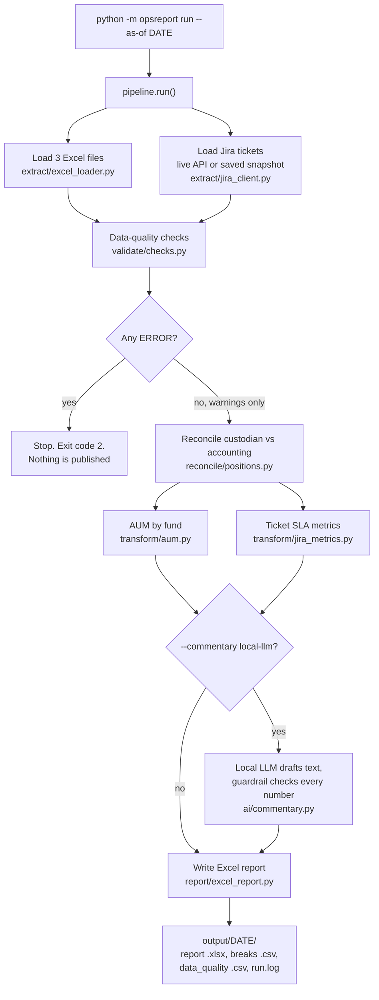
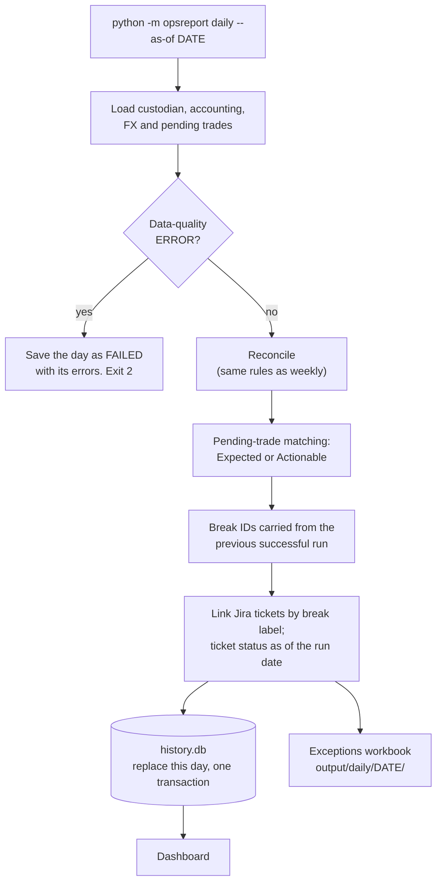

# Architecture: how the code works

Technical documentation for the pipeline. For the business meaning of the
terms used here (custodian, break, AUM), read [CONCEPTS.md](CONCEPTS.md) first.

## One run, start to finish



There are two runs. The **weekly** run above produces the 7-tab report. The
**daily** run (section "Daily run and history" below) reconciles each business
day, explains timing breaks with pending trades, and stores the results in a
SQLite history that feeds the analysts' exceptions file and the dashboard.

## Repository map

```
opsreport/                 the application
  __main__.py              command line: run (weekly), daily, backfill
  pipeline.py              the weekly run; builds the audit trail
  daily.py                 the daily run: pending trades, break IDs, tickets, history
  history.py               SQLite history store (one row set per business day)
  dashboard_data.py        every number on the dashboard, from the history
  config.py                reads .env and the YAML files in config/
  calendar.py              business-day maths with market holidays
  extract/
    excel_loader.py        reads the custodian, accounting and FX workbooks
    jira_client.py         Jira REST client, field mapping, snapshots
  validate/checks.py       data-quality rules (ERROR stops the run)
  reconcile/positions.py   compares the two books; classifies each break
  reconcile/pending.py     Expected vs Actionable, using pending trades
  transform/
    aum.py                 AUM by fund and week-over-week change
    jira_metrics.py        open / overdue / aging / SLA, as of a date
  report/excel_report.py   writes the 7-tab weekly workbook
  report/exceptions_report.py  the analysts' daily exceptions workbook
  ai/commentary.py         optional LLM commentary plus its fact-checker

dashboard/app.py           leadership dashboard (Streamlit); draws only

config/                    everything that changes without code changes
  funds.yaml               the funds and their custodian account numbers
  excel_layouts.yaml       column names and date formats of each source file
  jira_fields.yaml         Jira custom fields the report needs
  jira_field_lock.yaml     those fields' Jira ids, pinned per site
  recon.yaml               tolerances and materiality thresholds
  calendar.yaml            market holidays

data/
  raw/<date>/              the three input workbooks for each week
  expected/                answer keys: the breaks planted in the test data
  snapshots/               saved Jira pulls, so runs are reproducible offline
  daily/                   generated daily inputs (not in git; regenerate in ~5s)
  history.db               the daily history (not in git; rebuilt by backfill)

scripts/                   one-off helpers, not part of the weekly run
  generate_excel_data.py   creates the weekly synthetic workbooks and answer keys
  generate_daily_data.py   six months of daily inputs, answer keys, linked tickets
  jira_setup.py            creates the demo Jira project and custom fields
  seed_jira.py             fills it with 160 synthetic tickets

tests/                     automated tests; none need Jira, Ollama or the network
docs/                      CONCEPTS, ARCHITECTURE, RUNBOOK, INCIDENTS, AI_COMMENTARY
```

## Stage by stage

### 1. Extract: Excel (`extract/excel_loader.py`)

Three loaders return tables in one shared shape, so later stages never care
which system a row came from:

`source, as_of, fund_code, isin, ticker, description, asset_class, currency,
quantity, price, local_mv, fx_rate, base_mv`

| Source | What makes it awkward | How the loader copes |
|---|---|---|
| Custodian statement | Title rows above the header; one sheet per fund; numbers stored as text (`"25,000.00"`); a Total row and footer; a holding may be split over several rows | Finds the header row by scanning for `ISIN`; maps columns by header text; cleans numbers; keeps only rows for that account; adds split rows together |
| Fund accounting | Different column names; has accrued income | Maps columns by header text from config |
| FX rates | A currency may be missing or duplicated | Rejects missing, duplicate or non-positive rates |

Safety checks that stop the run with a clear message:

- **Date guard.** The date written inside each file must equal `--as-of`.
- **Control total.** The custodian rows that were read must add up to the
  statement's own Total row, within $1. Catches dropped or misread rows.
- **Known accounts only.** An unexpected or missing account sheet is an error.

### 2. Extract: Jira (`extract/jira_client.py`)

- Calls Jira's REST API with an API token from `.env`.
- Uses `POST /rest/api/3/search/jql` and follows `nextPageToken` page by page.
- Retries dropped connections, 429 (rate limited) and 5xx for calls that only
  read. A call that creates tickets is retried only on 429, because after a
  5xx or a dropped connection the first attempt may already have worked.
- Custom fields are looked up **by display name** (portable across Jira
  sites). Each field's id is also pinned in `jira_field_lock.yaml`; if a field
  is renamed, the run follows the id and raises a warning instead of stopping.
- Every live pull is saved as a **snapshot** with site URLs and account ids
  removed. Runs default to the snapshot, so tests and re-runs work offline.
  A live pull will not replace an existing snapshot unless `--refresh-snapshot`
  is given: the snapshot is the record of what a report was built from.

### 3. Validate (`validate/checks.py`)

| Severity | Effect | Checks |
|---|---|---|
| ERROR | Run stops, exit code 2 | Blank required field; same fund and ISIN twice; the same row twice on the custodian statement; ISIN fails its check digit; currency with no FX rate; duplicate Jira key |
| WARNING | Listed on the Data Quality tab | Quantity zero or negative; market value ≠ quantity × price; FX rate differs from the official file; Jira ticket missing a field or due date, Done without a resolved date, or resolved before it was raised; Jira field renamed; run date is not a business day; an open ticket predates the holiday calendar; report forced with `--allow-errors` |

Checks never repair data. They say what is wrong and where. The prior week's
files get the same position checks, because they feed the week-over-week change.

### 4. Reconcile (`reconcile/positions.py`)

The two position tables are joined on **fund + ISIN**, keeping rows that
exist on only one side. Each joined row is tested against the rules below
**in this order**; the first rule that matches names the break.

| Order | Break type | Rule |
|---|---|---|
| 1 | Missing Trade | Exists on one side only |
| 2 | Cash Break | Cash row, value differs by more than tolerance |
| 3 | Static Data | Currency differs between the two sides |
| 4 | Corporate Action | Quantity ratio is a split ratio (2, 3, 0.5, ...) and value is unchanged |
| 5 | Quantity Break | Quantities differ |
| 6 | Price Break | Prices differ by more than 0.05% and value differs |
| 7 | FX Rate | Local-currency value agrees but dollar value differs |
| 8 | Unexplained | Value differs, no rule matched |

Order matters. A wrong currency also changes the dollar value, so it must be
labelled Static Data before the FX rule sees it. Tolerances live in `recon.yaml`.

Each break also gets:

- a one-line **likely cause**, which also mentions a second difference the
  label would hide (for example a quantity break where the price differs too);
- an **exposure**: the dollar difference, except for an unprocessed corporate
  action, where the values still agree but the whole position carries the wrong
  quantity, so the position's value is used;
- a **materiality** band from that exposure. Breaks are listed largest exposure first.

### 5. Metrics (`transform/`)

- **AUM** = securities value + cash + accrued income, from fund accounting,
  with the custodian total alongside so a gap is visible.
- **Ticket metrics** are *point-in-time*: "open as of the Friday" means raised
  on or before it and not resolved by it. Ages are counted in business days
  using `calendar.yaml`.

### 6. Report (`report/excel_report.py`)

One workbook, seven tabs: Summary, Breaks, AUM, Ops SLA, Overdue Tickets,
Data Quality, Run Info. **Run Info** is the audit trail: a fingerprint
(SHA-256) of every input file, row counts, the git commit and library versions.

### 7. Optional AI commentary (`ai/commentary.py`)

Described in [AI_COMMENTARY.md](AI_COMMENTARY.md). In short: Python computes
every number; a local model only writes sentences; a fact-checker verifies
each number in the draft; on failure it retries once, then uses a fixed template.

## Daily run and history



**Pending-trade matching** (`reconcile/pending.py`) applies only to quantity
and missing-position breaks. The open trades on the position must explain the
*whole* quantity difference (buys and sells net off). If they do and no
settlement date has passed, the break is Expected. If a settlement date has
passed, it is Actionable with "settlement failed". If they explain only part,
it is Actionable and the note gives the unexplained amount. An open trade on a
position with no break is reported as a warning (stale trade report, or a
trade never booked).

**Break IDs** (`daily.py`) are `BRK-<first seen>-<fund>-<ISIN>`. If the same
fund and security was a break in the previous *successful* run, today's break
inherits its ID and first-seen date; `days_open` is business days since then.
Re-running an earlier day after later days exist does not re-chain the later
days; re-run the backfill from that day instead.

**Tickets** are linked through a Jira label `break-<ID>`, so no extra Jira
field is needed. Ticket status is computed *as of the run date* (Open, Overdue,
Resolved), not taken from Jira's current status, so history stays true to the
day. A ticket whose own dates are incomplete is linked but shown as Unknown.

**History store** (`history.py`, SQLite, schema version 2):

| Table | One row per | Holds |
|---|---|---|
| `runs` | business day | status OK / FAILED, counts, actionable $, errors, warnings, message, git commit, input fingerprints |
| `breaks` | day and break | type, status, explanation, likely cause, exposure, materiality, pricing vendor, first seen, days open, ticket and its status that day |
| `aum_daily` | day and fund | AUM components, the custodian total, holdings compared (for the match rate) and shares outstanding (for NAV impact) |
| `data_quality` | finding | severity, rule, detail, record |
| `tickets` | ticket | the latest Jira snapshot, with each ticket's break ID |

Saving a day deletes and re-inserts that day's rows in one transaction, so a
re-run is safe and a crash leaves the previous version intact. A failed day
is saved with its errors and no breaks.

The schema version lives in `PRAGMA user_version`. Opening an older database
upgrades it in place (`MIGRATIONS`: version 1 → 2 adds the two `aum_daily`
columns). Days saved before a column existed keep NULL there, and the dashboard
shows n/a for them rather than a wrong number; a backfill fills them in. A
database from a *newer* version of the code is refused.

**Backfill** runs each business day in order (NYSE calendar), records a bad
day and continues, writes the exceptions file only for the last day, and exits
2 if any day failed.

## Dashboard

`dashboard/app.py` only lays out filters, tiles and charts. Every figure comes
from `opsreport/dashboard_data.py`, which is unit-tested:

| Figure | Definition |
|---|---|
| As of | The last successful run inside the selected date range |
| Open breaks, exposure, aged, AUM | Point-in-time on the as-of day; actionable breaks only |
| Change arrows | Same figure for the same-length range just before |
| Open breaks over time | Actionable break-days in each period ÷ business days run in it |
| SLA on time | Tickets resolved in the range (or period) that met their due date |
| AUM over time | Value on the last run of each period |
| Recurring causes | Separate breaks per root cause (failed settlement, price by vendor, ...), not days, so one stuck break can't dominate |
| Match rate | 1 − breaks ÷ holdings compared (a holding on either side counts once). Second line leaves out Expected breaks. Only the fund filter applies |
| Aging profile | Open breaks per day by age band (`aging_bands` in `config/recon.yaml`); the 6+ bands equal the "aged over 5 days" tile |
| Roll-forward | Per successful run: *new* = actionable today but not on the previous run; *cleared* = the reverse. Failed days are skipped, so opening + new − cleared = closing holds exactly for any filter and grain |
| Days to clear | Business days from first seen to the run on which the break was gone |
| NAV impact | Per fund: sum of signed `base_mv_diff` on actionable breaks, excluding failed settlements, ÷ shares outstanding (cents per share) and ÷ AUM (% of NAV). Levels from `nav_impact` in `config/recon.yaml` |

Weekly periods end on Friday; monthly periods start on the 1st. The chart
colours are a fixed, colour-blind-checked palette: each break type keeps its
colour under any filter, and every chart has a table view.

## Month-end sign-off

`monthend.py` builds a `MonthEnd` for a calendar month from the same history
and the same `dashboard_data` functions, so the pack, the dashboard tab and
the daily figures can't disagree. Five checks per fund on the month's last
business day:

| Check | Source |
|---|---|
| Every day reconciled | `runs`: no FAILED day, no business day without a run |
| No high-materiality break | open actionable breaks with materiality High |
| NAV impact under 1¢ a share | `nav_impact_daily` on that day |
| No break older than 10 days | `days_open` above the last age band |
| No overdue ticket | tickets open and past due *as of* that day |

Status: Ready to sign (all pass), Needs attention (reasons listed by problem,
e.g. `Overdue tickets: 1 (OPSREC-107)`), or In progress (the last business day
hasn't run yet; checks show where the fund would stand today).
`report/monthend_report.py` writes the pack (Sign-off with blank sign-off
columns, Checks, Open at Month-end, Roll-forward, NAV Impact, Run Log) to a
file for `opsreport monthend` or to memory for the dashboard's download button.

## Security

- **Untrusted text stays text.** Ticket summaries come from Jira and security
  descriptions from vendor files. The workbook is written with formula and link
  conversion switched off, so a cell starting with `=` cannot become a live
  formula. CSV outputs prefix such cells with an apostrophe.
- **Credentials.** The Jira API token lives only in `.env` (never committed).
  The Jira URL must be `https://`, and a warning is raised if `.env` is readable
  by other users on the machine.
- **Snapshots are publishable.** Site URLs and account ids are removed and
  people's names are replaced by stable pseudonyms before a snapshot is saved.
- **CI** runs with a read-only token.

## Exit codes

| Code | Meaning |
|---|---|
| 0 | Report written |
| 1 | A source file, Jira or configuration problem. One clear line on screen; full detail in `output/run.log` |
| 2 | Data-quality ERROR. Nothing published |

## How it is tested

| Test file | What it proves |
|---|---|
| `test_reconcile.py` | The reconciliation finds **exactly** the breaks planted in the data (answer keys in `data/expected/`): none missed, none invented, rounding noise ignored |
| `test_excel_loader.py` | The loader survives real-world file changes: inserted, renamed or moved columns, dropped rows, wrong dates, split holdings |
| `test_jira_client.py` | Paging, retries, renamed or deleted fields, using recorded fake responses |
| `test_metrics_and_pipeline.py` | Point-in-time ticket logic, holidays, and a full end-to-end run |
| `test_cli.py` | Exit codes and clean error messages |
| `test_ai_commentary.py` | The fact-checker rejects wrong drafts and accepts correct ones |
| `test_daily_data.py` | The daily generator: every day reconciles exactly to its answer key; tickets link to breaks; the trend is present |
| `test_daily_run.py` | Pending-trade rules, loader validation, break IDs and days open, point-in-time ticket status, idempotent re-runs, failed days, the exceptions file, CLI |
| `test_dashboard.py` | Dashboard figures against direct calculations, filters, grouping consistency across grains, run health, exact identities (roll-forward, aging bands, match-rate counts), failed settlements never reaching NAV impact, and the real app rendered with every grain and filter |
| `test_monthend.py` | A hand-built clean month is Ready to sign; each check is then failed alone and must fail only that fund and check; failed and missing days; a month in progress; the pack's tabs and rows; CLI errors |

Tests read a frozen copy of the Jira snapshot (`tests/fixtures/snapshots/`), so
replacing the real one with a fresh pull can't change test results.

CI (GitHub Actions) runs on every push and pull request:

| Step | Tool | Fails when |
|---|---|---|
| Lint | ruff | Style or likely-bug patterns |
| Types | mypy | A value is used as the wrong type (e.g. FX rates passed where positions are expected) |
| Tests | pytest | Any test fails |
| Coverage | pytest-cov | Less than 90% of `opsreport/` is exercised by tests (currently about 97%) |

## Design choices worth knowing

- **Config over code.** Column names, tolerances, holidays and field names are
  YAML, so most upstream changes are a config edit with a review, not a code change.
- **Fail loudly.** A wrong number is worse than no number. Unexpected input
  stops the run with a message naming the file, sheet and record.
- **Reproducible.** Inputs are fingerprinted, Jira pulls are saved, and the
  synthetic data is generated from fixed random seeds.
- **One source of truth.** The exceptions file, the dashboard and every period
  view read the same daily rows.
- **Known simplifications.** One holiday calendar for all markets; AUM is total
  assets, not net of liabilities; shares outstanding are fixed per fund (real
  funds update them daily); the synthetic funds are small, so ordinary breaks
  cross the 1-cent line more often than at a large fund; each position gets one break type even if two
  things are wrong; trades don't move cash; daily tickets are generated with
  the data rather than created in Jira; all data is synthetic.
